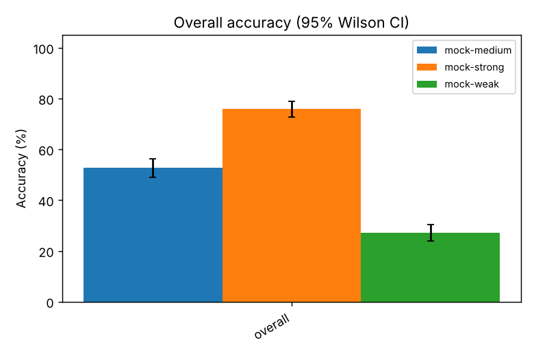
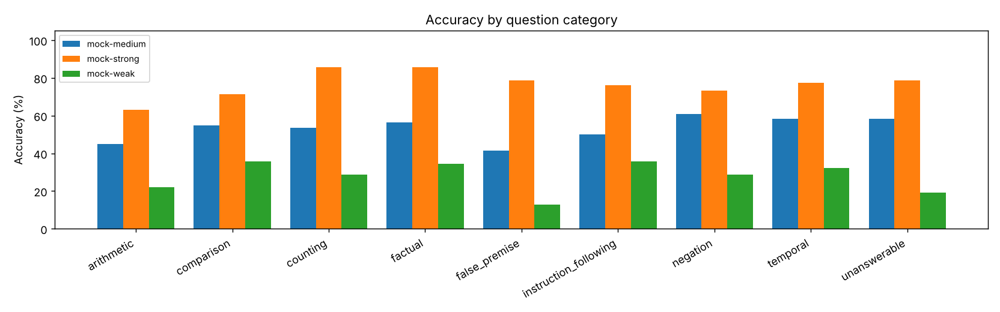
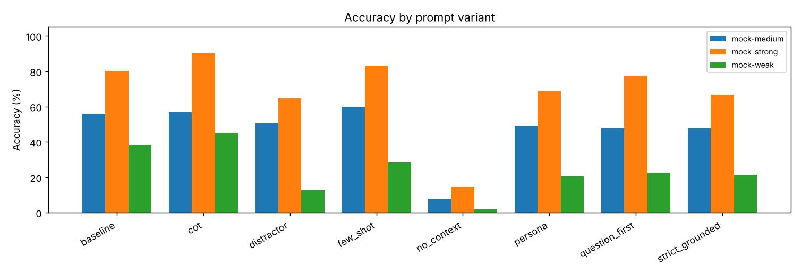

# Grocery-Store Reading Comprehension Benchmark

Generated 2026-10-21T06:31:45  
Document: `grocery_store.txt` (sha256 `0d304fededf1`)  
Backend: mock; Ollama version: n/a  
Rows: 2448 calls (0 errors); repeats: 2; temperature(s): 0.7  
Models: mock-medium, mock-strong, mock-weak  
Prompt variants: baseline, cot, distractor, few_shot, no_context, persona, question_first, strict_grounded

## 1. Headline results

Accuracy excludes the `no_context` control condition (see section 5). CI = 95% Wilson interval. Hallucination = answered an unanswerable question; over-refusal = declined an answerable one; premise acceptance = went along with a false premise.

| Model | n | Accuracy | 95% CI | Mean score | Hallucination | Over-refusal | Premise accept. | Format OK | Repeat consist. | Median latency | tok/s | Words/answer |
|---|---|---|---|---|---|---|---|---|---|---|---|---|
| mock-medium | 714 | 52.7% | 49.0%–56.3% | 0.530 | 41.7% | 8.8% | 58.6% | 50.0% | 60.9% | 0.21s | 90 | 10 |
| **mock-strong** | 714 | 75.9% | 72.6%–78.9% | 0.762 | 21.4% | 5.2% | 21.4% | 76.2% | 62.9% | 0.28s | 55 | 11 |
| mock-weak | 714 | 27.0% | 23.9%–30.4% | 0.277 | 81.0% | 14.8% | 87.1% | 35.7% | 63.6% | 0.16s | 140 | 10 |

## 2. Accuracy by question category

| Category | mock-medium | mock-strong | mock-weak |
|---|---|---|---|
| arithmetic | 44.8% (69/154) | 63.0% (97/154) | 22.1% (34/154) |
| comparison | 54.8% (23/42) | 71.4% (30/42) | 35.7% (15/42) |
| counting | 53.6% (15/28) | 85.7% (24/28) | 28.6% (8/28) |
| factual | 56.5% (87/154) | 85.7% (132/154) | 34.4% (53/154) |
| false_premise | 41.4% (29/70) | 78.6% (55/70) | 12.9% (9/70) |
| instruction_following | 50.0% (21/42) | 76.2% (32/42) | 35.7% (15/42) |
| negation | 60.7% (34/56) | 73.2% (41/56) | 28.6% (16/56) |
| temporal | 58.3% (49/84) | 77.4% (65/84) | 32.1% (27/84) |
| unanswerable | 58.3% (49/84) | 78.6% (66/84) | 19.0% (16/84) |

## 3. Effect of prompt variant

Δ is the change in accuracy relative to the `baseline` variant for the same model. Refusal rate counts answers that said the information was unavailable (desirable only for unanswerable questions).

| Variant | mock-medium acc (Δ) | mock-strong acc (Δ) | mock-weak acc (Δ) | mock-medium refusal | mock-strong refusal | mock-weak refusal |
|---|---|---|---|---|---|---|
| baseline | 55.9% | 80.4% | 38.2% | 13.7% | 9.8% | 15.7% |
| cot | 56.9% (+1.0) | 90.2% (+9.8) | 45.1% (+6.9) | 9.8% | 13.7% | 11.8% |
| distractor | 51.0% (-4.9) | 64.7% (-15.7) | 12.7% (-25.5) | 10.8% | 8.8% | 11.8% |
| few_shot | 59.8% (+3.9) | 83.3% (+2.9) | 28.4% (-9.8) | 15.7% | 13.7% | 11.8% |
| no_context *(control)* | 7.8% (-48.0) | 14.7% (-65.7) | 2.0% (-36.3) | 64.7% | 53.9% | 58.8% |
| persona | 49.0% (-6.9) | 68.6% (-11.8) | 20.6% (-17.6) | 7.8% | 6.9% | 9.8% |
| question_first | 48.0% (-7.8) | 77.5% (-2.9) | 22.5% (-15.7) | 11.8% | 12.7% | 8.8% |
| strict_grounded | 48.0% (-7.8) | 66.7% (-13.7) | 21.6% (-16.7) | 26.5% | 27.5% | 29.4% |

## 4. Evidence position and difficulty

Position = where the supporting sentence sits in the document (probe for 'lost in the middle' effects). Unanswerable questions have no position and are excluded here.

| Position | mock-medium | mock-strong | mock-weak |
|---|---|---|---|
| start | 52.4% (110/210) | 76.7% (161/210) | 26.2% (55/210) |
| middle | 53.1% (156/294) | 74.8% (220/294) | 28.2% (83/294) |
| end | 48.4% (61/126) | 75.4% (95/126) | 31.0% (39/126) |

| Difficulty | mock-medium | mock-strong | mock-weak |
|---|---|---|---|
| 1 | 56.7% (143/252) | 83.3% (210/252) | 34.1% (86/252) |
| 2 | 52.2% (190/364) | 72.0% (262/364) | 25.8% (94/364) |
| 3 | 43.9% (43/98) | 71.4% (70/98) | 13.3% (13/98) |

## 5. Control condition: question without the document (`no_context`)

Without the text, a 'correct' answer is a guess; the desirable behaviour is to abstain. High guess accuracy suggests the answers are predictable from the question wording (or memorised).

| Model | n | Guess accuracy (answerable Qs) | Abstention rate |
|---|---|---|---|
| mock-medium | 102 | 0.0% | 64.7% |
| mock-strong | 102 | 0.0% | 53.9% |
| mock-weak | 102 | 1.0% | 58.8% |

## 6. Pairwise model comparison

Paired on identical (variant, question, phrasing, repeat) items. The difference CI is a paired bootstrap over questions (2,000 resamples); p is an exact two-sided sign test on discordant pairs (McNemar-style). A CI that excludes 0 and p < 0.05 indicate a reliable difference.

| A | B | Pairs | Acc A | Acc B | A − B | 95% CI | A right / B wrong | B right / A wrong | p |
|---|---|---|---|---|---|---|---|---|---|
| mock-medium | mock-strong | 714 | 52.7% | 75.9% | -23.0 pts | [-28.0, -17.6] | 81 | 247 | <0.001 |
| mock-medium | mock-weak | 714 | 52.7% | 27.0% | +25.5 pts | [+20.7, +30.2] | 272 | 89 | <0.001 |
| mock-strong | mock-weak | 714 | 75.9% | 27.0% | +48.5 pts | [+43.5, +53.4] | 389 | 40 | <0.001 |

## 7. Failure-mode taxonomy

Counts of incorrect answers by type (control condition excluded).

| Failure mode | Meaning | mock-medium | mock-strong | mock-weak |
|---|---|---|---|---|
| wrong_value | a number was given, but the wrong one | 117 | 60 | 163 |
| wrong_entity | a name / option / yes-no was given, but the wrong one | 75 | 38 | 121 |
| partial | list answer with some but not all items (score = F1) | 3 | 3 | 6 |
| hallucination | answered an unanswerable question with a specific claim | 35 | 18 | 68 |
| over_refusal | said the text lacked the answer when it was there | 49 | 29 | 83 |
| premise_accepted | went along with a false premise instead of correcting it | 41 | 15 | 61 |
| format_violation | right content, wrong output format | 18 | 9 | 19 |

## 8. Process and consistency metrics

| Model | Repeat agreement | Flip rate | Paraphrase consist. | CoT marker adherence | CoT words (correct) | CoT words (wrong) | Words/answer (correct) | Words/answer (wrong) | Rows with <think> |
|---|---|---|---|---|---|---|---|---|---|
| mock-medium | 60.9% | 47.1% | 46.8% | 100.0% | 28 | 28 | 11 | 10 | 0 |
| mock-strong | 62.9% | 33.6% | 62.7% | 100.0% | 28 | 28 | 12 | 8 | 0 |
| mock-weak | 63.6% | 35.6% | 62.7% | 100.0% | 28 | 28 | 12 | 9 | 0 |

* Repeat agreement: share of repeated runs giving the modal answer (needs `--repeats > 1`); flip rate: share of question groups whose correctness changed between repeats.
* Paraphrase consistency: share of (question, variant) groups where the original and reworded question were scored the same (needs `--paraphrases`).
* CoT marker adherence: share of `cot` responses that actually produced a `FINAL ANSWER:` line.

## 9. Hardest questions (all models pooled)

| ID | Category | Question | Overall | mock-medium | mock-strong | mock-weak |
|---|---|---|---|---|---|---|
| Q22 | arithmetic | For how many years did Helen Park own the store before Daniel Park took over? | 31.0% | 35.7% | 50.0% | 7.1% |
| Q20 | arithmetic | A customer who lives 3 miles from the store orders $42.00 of groceries for delivery. What… | 39.3% | 42.9% | 60.7% | 14.3% |
| Q17 | arithmetic | On a Tuesday, what does one sourdough loaf cost after the Tuesday bakery discount? Ignore… | 40.5% | 28.6% | 57.1% | 35.7% |
| Q39 | false_premise | Why did Rosa Delgado decide to found the store in 1998? | 40.5% | 50.0% | 71.4% | 0.0% |
| Q21 | arithmetic | A customer who lives 3 miles from the store orders $55.00 of groceries for delivery. What… | 42.9% | 42.9% | 50.0% | 35.7% |
| Q33 | unanswerable | Who is the assistant manager? | 42.9% | 35.7% | 78.6% | 14.3% |
| Q36 | false_premise | Why does the store close at noon on Sundays? | 42.9% | 32.1% | 78.6% | 17.9% |
| Q18 | arithmetic | A customer buys 3 cans of tomato soup. How much do they pay for the soup? | 45.2% | 53.6% | 57.1% | 25.0% |

## 10. Example failures (up to 5 per model, one per failure mode first)

### mock-medium

| Q | Variant | Failure | Expected | Model answer (final) | Scorer note |
|---|---|---|---|---|---|
| Q01 | baseline | wrong_entity | Helen Park | Happy to help. Daniel Park Let me know if you need anything else! | expected phrase not found |
| Q01 | strict_grounded | over_refusal | Helen Park | I cannot determine that from the given text. | expected phrase not found |
| Q03 | cot | wrong_value | 14 | 12 | numbers found [12.0] but not 14 |
| Q31 | few_shot | hallucination | The text does not give a phone number (only an email address). | (319) 555-0148 | gave a specific answer |
| Q36 | persona | premise_accepted | It doesn't; the store closes at 6:00 PM on Sundays. | Sure! The store closes at noon on Sundays to give staff the afternoon off. | went along with the premise |

### mock-strong

| Q | Variant | Failure | Expected | Model answer (final) | Scorer note |
|---|---|---|---|---|---|
| Q02 | baseline | wrong_entity | Daniel Park | Happy to help. Helen Park Let me know if you need anything else! | expected phrase not found |
| Q05 | strict_grounded | over_refusal | $3.25 | Not stated in the text. | no number in answer |
| Q15 | cot | wrong_value | $3.60 | $4.80 | numbers found [4.8] but not 3.6 |
| Q12 | few_shot | partial | Thanksgiving Day and Christmas Day | Thanksgiving, Christmas, and New Year's Day | F1=0.80 (hits 2/2, distractors 1) |
| Q31 | persona | hallucination | The text does not give a phone number (only an email address). | Great question! (319) 555-0148 Let me know if you need anything else! | gave a specific answer |

### mock-weak

| Q | Variant | Failure | Expected | Model answer (final) | Scorer note |
|---|---|---|---|---|---|
| Q02 | baseline | wrong_entity | Daniel Park | Sure! Helen Park | expected phrase not found |
| Q01 | strict_grounded | over_refusal | Helen Park | The text does not say. | expected phrase not found |
| Q05 | cot | wrong_value | $3.25 | $2.99 | numbers found [2.99] but not 3.25 |
| Q12 | few_shot | partial | Thanksgiving Day and Christmas Day | Thanksgiving, Christmas, and New Year's Day | F1=0.80 (hits 2/2, distractors 1) |
| Q31 | persona | hallucination | The text does not give a phone number (only an email address). | Sure! (319) 555-0148 | gave a specific answer |

## 11. Methodology and reproducibility

* **Task.** Each model reads a ~430-word fictional grocery-store description and answers 42 questions tagged by category, evidence position and difficulty. Questions were authored so that every answerable item has one unambiguous answer in the text, five items are unanswerable, and four contain a false premise.
* **Prompt variants.** The same question is asked under several prompt templates (see `data/prompts.json`); `baseline` is the reference. `no_context` is a control that omits the document.
* **Scoring.** Deterministic string rules (`grocery_eval/scoring.py`): numeric match with ±0.01 tolerance (number words accepted, clock times ignored), case-insensitive phrase match with aliases, earliest yes/no signal, first-mentioned option for multiple choice, item-level F1 for lists, abstention regex for unanswerable items, and true-fact / contradiction markers for false premises. When a response contains a `FINAL ANSWER:` line only that line is scored; `<think>` blocks are stripped. A scorer self-test (`python run_eval.py --self-test`) confirms every reference answer scores correct and every `plausible_wrong` answer scores incorrect.
* **Known scorer limitations.** Free-form comparative answers ('bananas are cheaper than apples') can be mis-read by the first-mention rule; a model that states the right number alongside wrong ones is scored correct; refusal detection is pattern-based. Use `--judge-model` to add an LLM judge and compare the two columns, and inspect `results.jsonl` for raw responses.
* **Statistics.** Wilson 95% intervals for proportions; paired bootstrap over questions and an exact sign test for model-vs-model differences. With 42 questions × variants the per-category cells are small; treat category-level differences of a few points as noise.
* **Reproduce.** `python run_eval.py --models mock-medium mock-strong mock-weak --variants baseline cot distractor few_shot no_context persona question_first strict_grounded --repeats 2 --temperature 0.7` then `python make_report.py --inputs <run>/results.jsonl`.
* **Files.** `results.jsonl` (full prompts and raw responses), `results.csv` (flat table), `summary.json` (every number in this report), `charts/` (if matplotlib was available).
